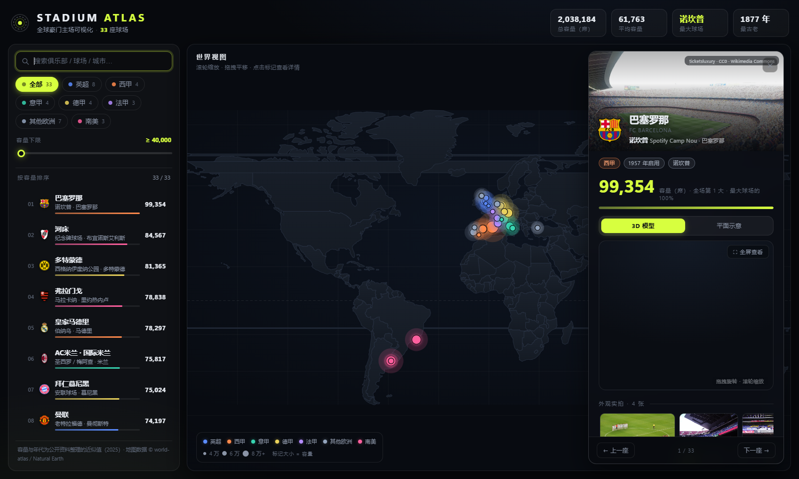

# STADIUM ATLAS · 豪门主场地图集

把世界足坛 33 座豪门主场放上地图的纯静态可视化网站。**零依赖、可离线**——双击 `index.html` 即可打开（无需服务器）。



## 功能

- **交互世界地图**：Miller 圆柱投影（176 国轮廓 + 经纬网），滚轮缩放、拖拽平移、`全球 / 欧洲 / 英伦 / 南美` 四个预设视角
- **球场标记**：颜色 = 联赛，大小 = 容量；悬停显示信息卡，点击定位并打开详情
- **筛选**：联赛多选、容量下限滑块、关键词搜索（俱乐部 / 球场 / 城市 / 中英文均可）
- **容量排行榜**：左侧列表按容量排序，含迷你比例条，与地图双向联动（悬停列表 → 地图标记高亮）
- **详情面板**：
  - **真实俱乐部队徽**：33 家俱乐部官方徽章取自 Wikipedia（本地缓存），圣西罗、奥林匹克等共用球场并排显示两枚；抓取失败时自动退回按主队配色生成的徽章
  - **球场实拍照片**：来自 Wikimedia Commons 的自由版权图片（1280px），作为详情面板的全幅 hero 头图，附作者与许可署名
  - **📸 外观实拍画廊**：每座球场 3~4 张真实外观/航拍实拍（ exterior 定向搜索 + 通用补位两轮筛选），横向滚动缩略图，点击打开灯箱大图（左右键/按钮翻页、Esc 关闭、含逐张署名）
  - **高保真可交互 3D 模型**：three.js 程序化生成——容量决定规模与看台层数（≥6.8 万为三层）、年代决定灯光形式（1995 年前四角灯塔 / 之后屋顶灯带）、**年代决定外立面建筑风格**（1975 年前砖石拱廊+角塔 / 1975–1999 混凝土竖鳍 / 2000 年后玻璃幕墙+主队色灯带；亮灯窗户、入口闸口、垂幅旗帜、广场灯柱按球场 id 种子随机，每座独一无二）、主队配色驱动座位纹理、大屏幕、LED 广告牌；含分块看台与过道、桁架悬挑屋顶、球门球网、观众点云、实时阴影与夜景光照；全屏模式内置「外观」预设机位
  - **⛶ 全屏自由视角**：左键旋转、右键/Shift 平移、滚轮无级缩放（可一直拉近到草皮/看台任意位置）、触屏双指捏合；内置 `环绕 / 航拍 / 看台席 / 草皮 / 俯瞰 / 斜角` 六个预设机位
  - **🌄 实拍漫游模式**：10 座有 360° 实拍全景的球场默认进入「站在照片里」的环视漫游（拖拽转头、滚轮缩放视野、自动巡航、可全屏），不再与 CG 模型混搭；其余球场默认展示 3D 模型
  - 平面看台示意图（2D 标签页，WebGL 不可用时的降级方案）
  - 容量数字滚动动画、与 TOP 球场的对比条形图、年代/坐标档案、一句话球场故事
- **顶栏统计**：球场数 / 总容量 / 平均容量 / 最大球场 / 最古老球场，随筛选实时刷新
- 移动端自适应（详情面板变为底部抽屉），支持 `Esc` 关闭、`←/→` 切换球场

## 目录结构

```
stadium-atlas/
├── index.html            # 页面骨架
├── assets/
│   ├── styles.css        # 全部样式
│   ├── app.js            # 交互逻辑（地图/筛选/详情/动画）
│   ├── stadium3d.js      # three.js 程序化 3D 球场生成器（自由相机 + 预设机位）
│   ├── panoview.js       # 实拍 360° 全景漫游器（球心相机 + 惯性 + 巡航）
│   ├── data.js           # 33 座球场数据（改这里即可增删球场）
│   ├── images.js         # 照片索引与署名（fetch-images.mjs 生成）
│   ├── gallery.js        # 外观图集索引与署名（fetch-gallery.mjs 生成）
│   ├── crests.js         # 队徽索引（fetch-crests.mjs 生成）
│   ├── panos.js          # 360° 全景索引与署名（build-panos.mjs 生成）
│   ├── world.js          # 世界地图投影数据（build-world.mjs 生成，勿手改）
│   ├── img/*.jpg         # 球场实拍照片（Wikimedia Commons，自由版权）
│   ├── img/gal/*.jpg     # 外观实拍图集（Wikimedia Commons，自由版权）
│   ├── img/crest/*.png   # 俱乐部队徽（Wikipedia，版权归各俱乐部）
│   ├── pano/<id>.js      # 全景 dataURL 数据（懒加载；file:// 下 WebGL 纹理必须走 dataURL）
│   └── vendor/three.min.js  # three.js r159 本地副本
├── build/
│   ├── build-world.mjs   # world-atlas TopoJSON → world.js
│   ├── fetch-images.mjs  # Commons 照片抓取（断点续传 + 429 退避）
│   ├── fetch-gallery.mjs # 外观图集抓取（两轮搜索 + 打分 + 断点续传）
│   ├── fetch-crests.mjs  # Wikipedia 队徽抓取（断点续传 + 429 退避）
│   ├── fetch-panos.mjs   # Commons 360° 全景抓取（2:1 比例过滤 + 打分）
│   ├── build-panos.mjs   # 全景 → dataURL JS（无头 Chrome 编码，2048px/q72）
│   ├── pick-veltins.mjs  # 按文件名手动指定 Commons 图片
│   ├── shoot-facade.mjs  # 拍摄指定球场的外观机位截图
│   ├── images-meta.json  # 照片元数据缓存（续传用）
│   ├── gallery-meta.json # 图集元数据缓存（续传用）
│   ├── crests-meta.json  # 队徽元数据缓存（续传用）
│   ├── panos-meta.json   # 全景元数据缓存（续传用）
│   ├── pano-raw/*.jpg    # 全景原始下载（4096px，编码后可删）
│   └── verify.mjs        # 无头浏览器自动化验证
└── shots/                # 验证截图
```

## 数据与素材说明

- 容量、启用年份为公开资料整理的**近似值**（截至 2025 年），坐标为球场大致位置
- 照片与 360° 全景来自 [Wikimedia Commons](https://commons.wikimedia.org/)，均为自由版权（多为 CC0 / CC BY / CC BY-SA），详情面板中附有作者、许可与来源链接；`assets/images.js` 与 `assets/panos.js` 中有完整署名清单
- **俱乐部队徽取自 Wikipedia，商标与版权归各俱乐部所有**，本项目仅作个人学习展示用途；若要公开发布站点，建议改用生成徽章（删除 `assets/crests.js` 即自动回退）或自行取得授权
- 圣西罗（米兰双雄）、奥林匹克（罗马双雄）为共用球场，各计一条
- 新增球场：在 `assets/data.js` 里照格式追加记录，再跑一次 `fetch-images.mjs` 补照片即可

## 开发与验证

```powershell
# 重新生成地图数据（需联网下载 world-atlas countries-110m.json）
node build\build-world.mjs <countries-110m.json 路径> assets\world.js

# 抓取/补齐球场照片、俱乐部队徽与 360° 全景（若网络无法直连，先设置代理环境变量）
$env:HTTP_PROXY='http://127.0.0.1:7897'; $env:HTTPS_PROXY=$env:HTTP_PROXY; $env:NODE_USE_ENV_PROXY='1'
node build\fetch-images.mjs          # 照片，断点续传；加 FORCE=1 全部重抓
node build\fetch-gallery.mjs         # 外观图集，断点续传；加 FORCE=1 全部重抓
node build\fetch-crests.mjs          # 队徽，断点续传；加 FORCE=1 全部重抓
node build\fetch-panos.mjs           # 360° 全景，断点续传；加 FORCE=1 全部重抓
node build\build-panos.mjs           # 全景编码为 dataURL（需要本机 Chrome）

# 自动化验证（需要本机 Chrome 与 puppeteer-core）
npm install puppeteer-core
node build\verify.mjs                # 功能检查 + 截图输出到 shots/
```

地图几何数据来自 [world-atlas](https://github.com/topojson/world-atlas)（Natural Earth 公共领域数据）；3D 由 [three.js](https://threejs.org/)（MIT）驱动。
